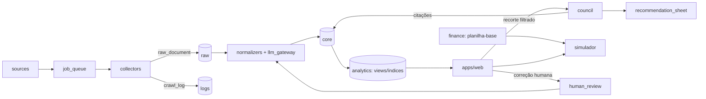

# NEXA LAB — Especificação Técnica para Desenvolvimento (Claude Code)

> **Origem:** Especificação Funcional v1.0 + Adendo v1.1 (Market Share, Conselho e Integração Financeira) — Outubro/2026
> **Responsável técnico:** Iago
> **Product owner:** Thaís Diniz
> **Classificação:** Confidencial — projeto pessoal e independente da Ambiente Consultoria
> **Uso deste arquivo:** salvar na raiz do repositório como `docs/SPEC.md` e referenciar no `CLAUDE.md` (seção 0 pode ser copiada integralmente para o `CLAUDE.md`).

---

## 0. Regras permanentes para o Claude Code

Estas regras valem para **todo** código, prompt, migração e tela gerados neste repositório. Nenhuma tarefa justifica violá-las.

### 0.1 Regras de dados (guardrails)

| ID | Regra |
|---|---|
| G-01 | **Nunca apresentar inferência como fato.** Todo campo inferido carrega `is_inferred = true` + `confidence` (0–1) + `evidence_id`. |
| G-02 | Todo dado relevante preserva **fonte, URL, data/hora de coleta e evidência textual**. A evidência deve ser abrível a partir do BI. |
| G-03 | **Proibido inventar** INCI, concentração, preço, avaliação, público, patente, fornecedor ou alegação. Ausência = `NULL` + motivo em `missing_reason`. |
| G-04 | Deduplicar produtos e variantes; alterações geram nova versão (histórico), nunca sobrescrita. |
| G-05 | Preço cheio ≠ preço promocional. Preço unitário (por ml/g) só é calculado quando volume/peso tiverem `confidence ≥ 0.9`. |
| G-06 | Avaliação de consumidor ≠ evidência científica. Tabelas e telas separadas. |
| G-07 | Seguidores, curtidas, buscas e tráfego **não** são proxy de tamanho de mercado nem de vendas. |
| G-08 | Não inferir geração/idade por estética. Apenas dado declarado, audiência disponível ou hipótese rotulada. |
| G-09 | Logs obrigatórios: erros, sites bloqueados, campos ausentes, cobertura real. **"Não coletado" ≠ "não existe".** |
| G-10 | Toda correção humana é registrada (quem, quando, valor anterior, motivo) e retroalimenta regras/prompts. |
| G-11 | Market share **observado**, **estimado** e **indisponível** são estados distintos. Estimativa nunca é rotulada como market share confirmado. |
| G-12 | Projeções financeiras são calculadas por **código determinístico**, nunca por texto livre do LLM. |

### 0.2 Regras de compliance

| ID | Regra |
|---|---|
| C-01 | Respeitar termos de uso, `robots.txt`, rate limits e políticas de cada plataforma. |
| C-02 | **Não burlar** CAPTCHA, login, paywall, bloqueio técnico ou anti-bot. Bloqueio = registrar em `crawl_log` com status `blocked` e seguir. |
| C-03 | Plataformas fechadas (TikTok, Instagram, Facebook): somente API oficial, exportação autorizada ou provedor licenciado. |
| C-04 | Não armazenar dados pessoais desnecessários. Identificadores de consumidores são hasheados (`author_hash`) e anonimizados no BI. |
| C-05 | User-agent identificável, backoff exponencial, limite de requisições por domínio configurável. |

### 0.3 Regras de arquitetura

| ID | Regra |
|---|---|
| A-01 | **Banco, coletores, ETL e BI são independentes do modelo de IA.** LLM é camada de interpretação, nunca o banco. |
| A-02 | Toda chamada a LLM passa pela camada `llm_gateway` (adapter por provedor: OpenAI, Anthropic, Google). Proibido importar SDK de provedor fora dela. |
| A-03 | Prompts versionados em arquivo (`/prompts/*.md`), com `prompt_version` gravado em cada saída gerada. |
| A-04 | Saídas de LLM para extração/classificação usam **JSON com schema validado** (Pydantic/Zod). Saída inválida = retry limitado + log, nunca gravação parcial. |
| A-05 | Toda resposta do Conselho cita os `record_id`/`evidence_id` que a sustentam. Resposta sem citação é rejeitada pela validação. |
| A-06 | Custos de tokens, navegador e coleta são registrados por execução (`cost_ledger`). |
| A-07 | Single-tenant. Sem lógica multi-tenant. |

---

## 1. Visão e escopo

Infraestrutura proprietária de inteligência de mercado para dermocosméticos/beleza que coleta, normaliza, historiza e analisa informação pública e legitimamente acessível sobre marcas, produtos, preços, ingredientes, consumidores, tendências e market share, com uma camada de análise por cinco agentes (Conselho NEXA) e um simulador financeiro vinculado à planilha-base.

**Princípio central:** cobertura + qualidade + rastreabilidade + normalização + análise + detecção de padrões, lacunas e sinais fracos. Volume de dados não é objetivo.

**Fora de escopo:** perfis individuais de consumidores; promessa de margem/vendas; fórmula final de produto; garantia de FPS/eficácia.

---

## 2. Decisões técnicas aprovadas

As decisões abaixo foram aprovadas por Iago em 16/10/2026 e são **definitivas para o desenvolvimento**. Alterações exigem nova aprovação registrada nesta tabela.

| ID | Decisão | Definição | Justificativa | Status |
|---|---|---|---|---|
| DEC-01 | Banco de dados | Supabase (PostgreSQL + `pgvector` + `pg_cron`) | Relacional + texto + embeddings no mesmo banco; RLS; storage para HTML bruto | Aprovada |
| DEC-02 | Linguagem dos coletores/ETL | Python 3.12 (`httpx`, `selectolax`, `extruct` para JSON-LD/schema.org, `Playwright` só quando permitido) | Ecossistema maduro de scraping estruturado e NLP | Aprovada |
| DEC-03 | Orquestração/agendamento | Fila de jobs em Postgres (tabela `job_queue`) + worker Python; agendamento via `pg_cron` ou GitHub Actions | Evita infraestrutura extra no MVP | Aprovada |
| DEC-04 | BI / interface | **Interface própria** (Next.js + Supabase) | Power BI/Looker/Metabase não atendem bem: botão "Analisar com Conselho", correção de classificação pela Thaís (writeback), simulador com premissas editáveis e abertura de evidência | Aprovada |
| DEC-05 | Camada LLM | `llm_gateway` próprio (ou LiteLLM) com roteamento por tarefa | Exigência A-01/A-02 | Aprovada |
| DEC-06 | Modelos por tarefa | Extração: modelo de menor custo com JSON mode; Conselho: modelo de maior capacidade; revisão crítica: segundo provedor | Controle de custo + comparação de pareceres | Aprovada (benchmark na Fase 1) |
| DEC-07 | Embeddings | Modelo de embedding definido por benchmark na Fase 1 | Deduplicação semântica e busca de evidências | Aprovada (modelo definido na Fase 1) |
| DEC-08 | Fontes sociais | Levantar API/custo/cobertura por plataforma (ver §16, Q-06) | Compliance C-03 | Aprovada (levantamento na Fase 0) |
| DEC-09 | Fontes de market share/sell-out | Levantar bases licenciáveis no Brasil (ver §16, Q-14) | Módulo C depende disso | Aprovada (levantamento na Fase 0) |
| DEC-10 | Hospedagem do worker | VPS ou serviço de containers | Playwright exige runtime com browser | Aprovada (provedor a escolher na Fase 0) |

> **Fora do escopo de desenvolvimento:** titularidade de dados, código, prompts, documentação, credenciais e confidencialidade (observação de governança do Adendo v1.1) é tratada entre as partes, fora deste repositório e deste backlog.

---

## 3. Arquitetura

### 3.1 Camadas

| # | Camada | Função | Componente técnico |
|---|---|---|---|
| 1 | Fontes | Sites oficiais, e-commerce, marketplaces, redes sociais, comunidades, avaliações, tendências, fontes científicas/regulatórias | `sources` (cadastro) |
| 2 | Coletores | API oficial/licenciada → crawler HTTP → navegador automatizado (último recurso, se permitido) | `collectors/` |
| 3 | Banco bruto | HTML/texto/JSON, URL, data, origem, hash, versão | schema `raw` + Storage |
| 4 | Normalização por IA | Categoria, benefício, ingrediente, público, formato, posicionamento, sentimento, tema | `normalizers/` + `llm_gateway` |
| 5 | Banco analítico | Modelo padronizado, histórico, pronto para BI | schema `core` + `analytics` |
| 6 | BI interativo | Filtros, rankings, evolução, comparações, clusters, lacunas | `apps/web` |
| 7 | Conselho NEXA | 5 agentes analisam recorte filtrado, registram divergências e decisão | `council/` |
| 8 | Radar | Alertas, sinais emergentes, white spaces, hipóteses | `radar/` |
| 9 | Simulador financeiro | Planilha-base versionada + cenários recalculados | `finance/` |

### 3.2 Fluxo de dados



### 3.3 Estrutura de repositório (proposta)

```
nexa-lab/
├── CLAUDE.md
├── docs/
│   ├── SPEC.md                  # este arquivo
│   ├── data-dictionary.md       # gerado a partir das migrations
│   ├── architecture.md
│   └── coverage-reports/
├── supabase/
│   ├── migrations/
│   └── seed/                    # lista-mãe de marcas, taxonomias
├── packages/
│   ├── collectors/              # por tipo de fonte
│   ├── normalizers/
│   ├── llm_gateway/             # adapters openai | anthropic | google
│   ├── council/
│   ├── radar/
│   ├── finance/                 # motor de cálculo determinístico
│   └── shared/                  # schemas Pydantic, utils, logging
├── prompts/
│   ├── extraction/
│   ├── classification/
│   └── council/
├── apps/
│   └── web/                     # BI + Conselho + simulador
├── tests/
│   ├── fixtures/                # HTML salvo para testes offline
│   └── eval/                    # golden set para avaliação de extração
└── config/
    ├── sources.yaml
    └── rate_limits.yaml
```

---

## 4. Modelo de dados

### 4.1 Padrão de campo rastreável

Todo atributo sujeito a inferência ou extração por IA segue o padrão:

| Coluna | Tipo | Descrição |
|---|---|---|
| `<campo>` | conforme | Valor |
| `<campo>_is_inferred` | boolean | `true` se não declarado pela fonte |
| `<campo>_confidence` | numeric(3,2) | 0.00–1.00 |
| `<campo>_evidence_id` | uuid FK → `core.evidence` | Trecho que sustenta o valor |

Para atributos multivalorados (benefícios, claims, ingredientes), usar tabela associativa com as mesmas colunas de rastreabilidade.

### 4.2 Schemas

| Schema | Conteúdo |
|---|---|
| `raw` | Documentos brutos, respostas de API, snapshots |
| `core` | Entidades normalizadas e versionadas |
| `analytics` | Views materializadas, índices NEXA, agregações para BI |
| `finance` | Planilha-base, premissas, cenários |
| `council` | Sessões, pareceres, fichas de recomendação |
| `ops` | Jobs, logs, custos, cobertura, revisões humanas |

### 4.3 Tabelas principais

#### `ops`

| Tabela | Campos-chave |
|---|---|
| `source` | id, type (`official_site`, `ecommerce`, `marketplace`, `social_api`, `forum`, `trends`, `scientific`, `regulatory`, `market_data`), name, base_url, access_method (`api`, `licensed`, `crawler`, `browser`, `manual`), tos_reviewed_at, robots_allowed, rate_limit_rps, active |
| `crawl_run` | id, source_id, started_at, finished_at, status, pages_fetched, pages_blocked, pages_failed, cost_brl |
| `crawl_log` | id, crawl_run_id, url, http_status, outcome (`ok`, `blocked`, `captcha`, `login_required`, `not_found`, `parse_error`, `robots_disallowed`), message, created_at |
| `job_queue` | id, job_type, payload jsonb, priority, status, attempts, scheduled_for, locked_at |
| `cost_ledger` | id, run_type, run_id, provider, model, tokens_in, tokens_out, browser_seconds, cost_brl, created_at |
| `human_review` | id, entity_table, entity_id, field, old_value, new_value, reason, reviewer, created_at, applied_to_rules boolean |
| `coverage_report` | id, period, brands_targeted, brands_collected, skus_collected, fields_completeness jsonb, blocked_sources jsonb |

#### `raw`

| Tabela | Campos-chave |
|---|---|
| `raw_document` | id, source_id, crawl_run_id, url, fetched_at, content_hash (sha256), content_type, storage_path, structured_data jsonb (JSON-LD/schema.org extraído), http_headers jsonb |

#### `core` — mercado e produto

| Tabela | Campos-chave |
|---|---|
| `brand` | id, name, official_url, country, founded_year, priority_level (`P1-A`, `P1`, `P2`), nexa_focus, competitive_archetype, positioning, declared_audience, inferred_audience (+rastreio), sales_channels text[], price_tier, founder_influencer, value_proposition, declared_differentials, marketplace_presence jsonb, social_handles jsonb, approx_sku_count, last_collected_at |
| `brand_version` | histórico de alterações de `brand` (SCD tipo 2: valid_from, valid_to) |
| `product` | id, brand_id, canonical_name, url, category_id, subcategory_id, format_id, status (`launch`, `permanent`, `limited`, `discontinued`), launch_date (+rastreio), skin_type text[], body_area text[], use_occasion, suggested_frequency, spf_declared, target_audience_declared, dedup_key, first_seen_at, last_seen_at |
| `product_variant` | id, product_id, variant_name, shade, volume_value, volume_unit (`ml`, `g`, `un`) (+rastreio), gtin/ean quando publicado |
| `price_observation` | id, variant_id, source_id, observed_at, list_price, promo_price, currency, unit_price_per_ml_g (nulo se G-05 não atendido), is_kit, availability (`in_stock`, `out_of_stock`, `unknown`), evidence_id |
| `ingredient` | id, inci_name (normalizado), common_name, function_class |
| `product_ingredient` | product_id, ingredient_id, position_in_inci, is_highlighted_active, declared_concentration, concentration_unit, (+rastreio) |
| `claim` | id, product_id, claim_text_exact, claim_type (`benefit`, `efficacy`, `metric`, `safety`, `sustainability`), metric_value, (+rastreio) |
| `benefit` / `product_benefit` | taxonomia + associação com flag principal/secundário |
| `packaging` | product_id, type, material, dispensing_mechanism, portability, refill_available, visual_notes, (+rastreio) |
| `review_aggregate` | variant_id, source_id, observed_at, avg_rating, review_count, positive_themes jsonb, negative_themes jsonb |
| `technology_asset` | id, brand_id, name, type (`patent`, `trademark`, `proprietary_active`, `technology`), verification_status (`confirmed`, `declared`, `unverified`), evidence_id |
| `evidence` | id, raw_document_id, url, excerpt, selector_or_offset, captured_at |

#### `core` — voz do consumidor

| Tabela | Campos-chave |
|---|---|
| `consumer_signal` | id, source_id, platform, external_public_id (quando permitido), url, original_text, language, published_at, collected_at, author_hash, engagement jsonb (métricas públicas), related_brand_id, related_product_id |
| `signal_classification` | signal_id, voice_type (taxonomia §6.2), theme, need, context, intensity (1–5), signal_phrase_match, sentiment, confidence, prompt_version, model, reviewed boolean |
| `trend_series` | id, term, source (`google_trends`, `internal_signals`), region, period_start, period_end, relative_interest, note (`relative_not_absolute`) |

#### `core` — market share (Módulo C)

| Tabela | Campos-chave |
|---|---|
| `market_size` | id, category_id, subcategory_id, channel, uf, municipality_or_region, period, revenue, units, universe_definition, source, base_year, scope, status (`observed`, `estimated`, `unavailable`) |
| `market_share_estimate` | id, brand_id, product_id, category_id, subcategory_id, channel, uf, municipality_or_region, period, revenue_value, units_value, share_value_pct, share_volume_pct, status (`observed`, `estimated`, `unavailable`), sell_type (`sell_in`, `sell_out`), method, assumptions text, bias_notes, coverage_notes, range_min, range_max, confidence, comparability_restrictions, source, base_year |

#### `council`

| Tabela | Campos-chave |
|---|---|
| `scenario_snapshot` | id, filters jsonb, record_ids uuid[], created_by, created_at, data_hash |
| `council_session` | id, scenario_id, context_version, models jsonb, prompt_versions jsonb, status, cost_brl, created_at |
| `council_opinion` | id, session_id, director (`scientific`, `innovation`, `behavior`, `brand`, `strategy`), opinion jsonb, cited_record_ids uuid[], confidence |
| `recommendation_sheet` | id, session_id, version, blocks jsonb (9 blocos §10.3), divergences jsonb, devils_advocate, eliminatory_criteria, next_experiments, decision, decided_by, decided_at, previous_sheet_id |

#### `finance`

| Tabela | Campos-chave |
|---|---|
| `model_version` | id, file_name, imported_at, file_hash, notes, is_baseline |
| `assumption` | id, model_version_id, key, value, unit, status (`confirmed`, `estimated`, `not_budgeted`), source_cell, notes |
| `scenario` | id, model_version_id, recommendation_sheet_id, tier (`conservative`, `base`, `ambitious`), overrides jsonb, results jsonb, created_at |

### 4.4 Deduplicação e versionamento

- `dedup_key` de produto = normalização de (marca + nome canônico + formato + volume) + similaridade de embedding acima de limiar calibrado na Fase 1.
- Variantes agrupadas por `product_id`; GTIN/EAN, quando publicado, é chave forte.
- Alteração detectada por diff de `content_hash` + diff de campos extraídos → nova linha em tabela de versão / nova `price_observation`.
- Produto não encontrado em N coletas consecutivas → candidato a `discontinued` (status inferido, com flag).

---

## 5. Módulo A — Inteligência competitiva

### 5.1 Estratégia de coleta por ordem de preferência

1. API oficial ou feed licenciado.
2. Dados estruturados na página (JSON-LD `Product`, `Offer`, `AggregateRating`; sitemaps de produto).
3. Crawler HTTP com parser.
4. Navegador automatizado (Playwright) apenas para páginas renderizadas por JS, sem burlar bloqueios (C-02).

### 5.2 Descoberta de páginas e detecção de alterações

- Sitemaps XML (`/sitemap.xml`, `/sitemap_products*.xml`) como fonte primária de URLs.
- Varredura de páginas de categoria como fonte secundária.
- `ETag`/`Last-Modified` quando disponíveis; caso contrário, `content_hash`.
- Plataformas de e-commerce identificadas por fingerprint (VTEX, Shopify, Nuvemshop, Magento etc.) → parsers específicos reutilizáveis.

### 5.3 Campos mínimos

**Por marca:** marca; URL oficial; país/origem; fundação; posicionamento; público declarado/inferido (com flag); canais de venda; faixa de preço; categorias; quantidade aproximada de SKUs; arquétipo competitivo; fundador/influenciador; diferenciais declarados; proposta de valor; presença em marketplaces; redes sociais; data da última coleta.

**Por produto/SKU:**
- Identificação: marca, nome, URL, categoria, subcategoria, formato.
- Preço: cheio, promocional, por ml/g/unidade, histórico, kits.
- Físico: volume/peso, variantes, cores/tons, disponibilidade/ruptura.
- Composição: INCI, ativos destacados, concentração declarada.
- Benefícios: principal, secundários, claims exatos, FPS e métricas declaradas.
- Uso: tipo de pele/necessidade, região do corpo, ocasião, frequência.
- Embalagem: tipo, material, mecanismo, portabilidade, refil, percepção visual.
- Público declarado; geração/idade apenas com evidência ou como inferência rotulada.
- Avaliações: média, quantidade, temas positivos/negativos, reclamações recorrentes.
- Ciclo: data de lançamento, status.
- Diferenciação: diferenciais, tecnologias, patentes/ativos proprietários confirmados.
- Rastreio: fonte, URL, data/hora, evidência, confiança da extração.

---

## 6. Módulo B — Social listening

### 6.1 Fontes e regras

| Fonte | O que extrair | Método permitido |
|---|---|---|
| TikTok / Instagram / Facebook | Comentários, temas, creators, formatos, sinais | API oficial, provedor licenciado, acesso permitido |
| YouTube | Vídeos, comentários, reviews, rotinas, comparativos, reclamações | YouTube Data API |
| Reddit / fóruns / comunidades | Discussões espontâneas, linguagem, problemas, soluções improvisadas | API oficial / crawler conforme termos |
| Marketplaces / lojas | Avaliações verificadas, estrelas, perguntas, satisfação/insatisfação, preço | API do marketplace / crawler conforme termos |
| Google Trends | Interesse relativo, sazonalidade, regiões, termos relacionados | Fonte oficial; **nunca tratar como tamanho de mercado** |
| Busca / pesquisas relacionadas | Perguntas frequentes, autocomplete (se permitido), vocabulário | Conforme termos |

**Coleta separada da interpretação:** `consumer_signal` (dado) e `signal_classification` (interpretação) são tabelas distintas; reclassificação não altera o dado original.

### 6.2 Taxonomia de voz do consumidor

`necessidade_dor`, `desejo`, `objecao`, `frustracao`, `elogio`, `abandono`, `recompra`, `pedido_explicito`, `solucao_improvisada`, `comparacao`, `medo_risco`, `sensorial`, `embalagem`, `preco_valor`, `eficacia_percebida`, `confianca`, `sustentabilidade`, `praticidade`, `inclusao`, `estetica_desejo`.

**Frases-sinal (seed, expandir por revisão):** "eu queria que…", "odeio quando…", "não consigo usar…", "seria perfeito se…", "abandonei porque…", "é trabalhoso…", "não funciona em mim…".

**Saída obrigatória por sinal:** TEMA + NECESSIDADE + CONTEXTO + INTENSIDADE + FREQUÊNCIA (frequência calculada na agregação) + confiança. Sentimento isolado é insuficiente.

---

## 7. Módulo C — Market share e atratividade geográfica

### 7.1 Fórmulas de referência

- **Share em valor (%)** = receita da marca no recorte ÷ receita total do mercado no mesmo recorte × 100
- **Share em volume (%)** = unidades da marca no recorte ÷ unidades totais do mercado no mesmo recorte × 100
- Recorte sempre explicita: **categoria, território, canal, período e universo.**
- Participação nacional da empresa ≠ participação em nicho.

### 7.2 Fontes prioritárias

Dados públicos auditáveis de empresas e associações setoriais; relatórios licenciados de institutos (quando contratados); dados de varejistas/marketplaces obtidos legitimamente; bases públicas de comércio/produção; informações oficiais de distribuição. Sempre diferenciar **sell-in** de **sell-out**.

### 7.3 Estimativa indireta

Permitida apenas com status `estimated`, documentando premissas, viés, cobertura, intervalo (`range_min`/`range_max`) e confiança. Insumos aceitáveis: faixas de faturamento publicadas, distribuição/presença em varejo, posição de vendas fornecida pela plataforma, indicadores públicos de demanda, amostras de painel. **Seguidores, avaliações, buscas e tráfego não equivalem a vendas (G-07).**

### 7.4 Análise de onde lançar

Variáveis: região/UF/cidade, demanda por necessidade, perfil socioeconômico agregado, clima/estação, concorrência, poder aquisitivo, custo de mídia, frete, prazo logístico, acesso a influenciadores e varejo. Nenhuma região é declarada "melhor" sem confronto entre demanda, custos e evidências.

### 7.5 Comportamento sem base defensável

Tela exibe **"DADOS INSUFICIENTES"** e o plano de aquisição de dados necessário.

---

## 8. Índices analíticos NEXA

Implementar como views em `analytics`, com fórmula documentada e versionada (`index_definition_version`). Separar visualmente **métrica observada** de **índice criado pelo NEXA**.

| Índice | Lógica |
|---|---|
| Saturação | Ofertas semelhantes + concentração de marcas + similaridade de benefícios/formatos |
| Dor | Frequência + intensidade + recorrência de reclamações/necessidades |
| Desejo | Engajamento, avaliações positivas, intenção expressa, linguagem aspiracional, prova social (com cautela) |
| Recompra potencial | Frequência natural de uso + duração estimada + sinais de recompra em avaliações |
| Diferenciação | Distância em relação às ofertas existentes (benefício, formato, ciência, experiência) |
| Tendência | Crescimento temporal + diversidade de fontes + persistência (não apenas viralização) |
| White space | Dor/desejo elevados + oferta insuficiente/baixa satisfação + viabilidade preliminar |
| Confiança | Qualidade da fonte + atualidade + completude + confirmação cruzada |

**Pendência:** pesos e normalização de cada componente não estão definidos na especificação funcional → calibrar na Fase 1 com validação da Thaís (ver §16, Q-17).

**Classificação de tendência:** `moda_passageira`, `em_formacao`, `consolidada`, `macrotendencia`, `sinal_fraco`.

---

## 9. BI interativo

### 9.1 Telas

| # | Tela | Conteúdo |
|---|---|---|
| 01 | Visão de Mercado | Nº de marcas/SKUs, categorias, faixas de preço, formatos, benefícios, concentração competitiva |
| 02 | Mapa de Concorrentes | Marcas por preço, ciência, desejo, comunidade, autoridade, variedade, inovação |
| 03 | Produto & Formato | Crescimento, preços, benefícios, ativos, avaliações, saturação por formato |
| 04 | Ingredientes & Ciência | Ativos mais usados, associações, claims, tecnologias, ativos proprietários, lacunas |
| 05 | Voz do Consumidor | Dores, desejos, reclamações, abandono, recompra, temas emergentes, citações representativas |
| 06 | Tendências | Evolução, velocidade, aceleração/desaceleração, sinais fracos, Brasil × exterior (futuro) |
| 07 | Preço & Valor | Distribuição, preço/ml-g, promoções, avaliação × preço, posicionamento |
| 08 | Embalagem & Experiência | Formatos, mecanismos, portabilidade, refil, sustentabilidade, conveniência |
| 09 | White Spaces | Alta dor/conversa × baixa oferta ou satisfação — **sempre rotulado como hipótese** |
| 10 | Conselho NEXA | Cenário + 5 pareceres + divergências + decisão |
| 11 | Market Share e Potencial Regional | Share por marca/categoria, ranking canal/região, evolução, concentração (top 5), mapa de demanda, preço praticado, intensidade competitiva, distribuição, custo de atendimento, lacunas |
| 12 | Simulador de Viabilidade e Meta NEXA | Seleção de categoria, formato, embalagem, preço, região, canal, volume, orçamento → recálculo vs. planilha-base com alertas |

### 9.2 Filtros (combináveis e globais)

Categoria/subcategoria · marca · produto · formato · benefício · necessidade · ativo/ingrediente · faixa de preço · preço por ml/g · tipo de pele · área do corpo · público/geração (quando sustentado) · canal · plataforma · sentimento/tema · avaliação · volume de avaliações · tendência · data/período · lançamento · nível de inovação · nível de evidência/confiança · UF/região (Módulo C).

### 9.3 Requisitos transversais de UI

- Todo valor clicável abre a **evidência** (excerpt + URL + data de coleta).
- Valores inferidos com marcação visual distinta e tooltip de confiança.
- Exportação do recorte filtrado (CSV/XLSX).
- Correção de classificação inline pela Thaís → grava em `ops.human_review`.
- Indicador de cobertura por tela ("X de Y marcas coletadas; Z fontes bloqueadas").
- Botão **"Analisar com Conselho NEXA"** em todas as telas 01–09 e 11.

---

## 10. Conselho NEXA

### 10.1 Fluxo

1. Usuário aplica filtros → sistema cria `scenario_snapshot` (filtros + `record_ids` + hash).
2. Montagem do contexto: recorte necessário + contexto permanente do NEXA (base de conhecimento) + evidências.
3. Cinco agentes executam (paralelo) com prompts próprios e schema de saída validado.
4. Rodada de debate: cada agente recebe os pareceres dos demais e registra concordâncias/divergências.
5. Agente consolidador gera `recommendation_sheet` com 9 blocos.
6. Validação automática: toda afirmação factual com `cited_record_ids`; afirmações sem citação são marcadas como hipótese ou rejeitadas (A-05).
7. Decisão humana registrada com versão.

### 10.2 Diretores

| Diretor | Foco |
|---|---|
| Científico | Eficácia plausível, formulação, ativos, estabilidade, segurança, testes, ANVISA, claims |
| Inovação | Novidade, sinais fracos, tecnologias, formatos, concorrentes emergentes, copyability |
| Comportamento | Necessidade humana, gerações, rotina, ocasião, adesão, influência intergeracional |
| Marca | Desejo, clareza, narrativa, embalagem, demonstração, creator fit, comunidade |
| Estratégia | Mercado, preço, margem, recorrência, MOQ, CAC, escala, barreiras |

### 10.3 Ficha de Recomendação NEXA — 9 blocos obrigatórios

| # | Bloco | Conteúdo mínimo |
|---|---|---|
| 1 | Mercado e Região | Até 3 regiões prioritárias (UF/cidade/canal), demanda estimada, tamanho acessível, concentração, barreiras logísticas, canais, justificativa comparativa |
| 2 | Consumidor | Público primário/secundário, faixa etária só se sustentada, necessidade não atendida, comportamento de compra, ocasião/frequência, quem escolhe/paga/usa, objeções, disposição a pagar a validar |
| 3 | Produto e Posicionamento | Categoria/subcategoria, benefício principal e secundários, proposta de valor, formato recomendado + **mínimo 2 alternativas**, diferenciação, motivo de recompra |
| 4 | Formulação e Ciência | Briefing preliminar: classes de ingredientes, ativos candidatos, mecanismos, concentrações só se sustentadas, compatibilidades, sensorial, estabilidade, segurança, ensaios, viabilidade industrial, ANVISA, limites de alegação. **Sem fórmula final; sem garantia de FPS/eficácia** |
| 5 | Embalagem e Especificações | Primária/secundária, capacidade g/ml, dimensões-alvo a validar, material, mecanismo, vedação, barreira, compatibilidade, resistência, higiene, portabilidade, refil, rotulagem, acabamento, identidade visual, custo-alvo, alternativas de fornecedores; itens que exigem teste físico/cotação |
| 6 | Preço e Economia Unitária | Faixa de preço, preço/g-ml, comparáveis, custo-alvo máximo, margem bruta/contribuição/líquida, ponto de equilíbrio, retorno, sensibilidade (descontos, impostos, frete, CAC, canal) — **números vindos do motor `finance/`** |
| 7 | Aquisição e Vendas | Canais, estratégia de lançamento, regiões, conteúdo demonstrável, influenciadores, hipótese de CAC, conversão, ticket, vendas/dia-mês, recompra, retenção, testes comerciais |
| 8 | Concorrência e Defesa | Concorrentes diretos/indiretos, substitutos, faixas de share quando confiáveis, diferenciais copiáveis × defensáveis, patentes verificadas, riscos, contramedidas |
| 9 | Riscos e Decisão | Parecer dos 5, discordâncias, advogado do diabo, critérios eliminatórios, próximos experimentos, investimento adicional, decisão |

**Decisões permitidas:** `DESCARTAR` · `OBSERVAR` · `APROFUNDAR` · `VALIDAR_COM_CONSUMIDOR` · `DESENVOLVER_CONCEITO` · `PROTOTIPAR`.

**Saída no BI:** resumo executivo; tabela comparativa de cenários; ficha técnica preliminar; recomendação comercial/regional; cenários financeiros; evidências clicáveis; responsáveis; data; versão e decisões anteriores. Exportação **PDF e planilha**.

### 10.4 Base de conhecimento permanente

Arquivos existentes do NEXA ingeridos em `council.knowledge_document` (texto + chunks + embeddings), versionados. Recuperação por similaridade + filtros. **Pendência:** inventário dos arquivos existentes (ver §16, Q-11).

---

## 11. Integração financeira (Módulo D)

### 11.1 Planilha-base

- Arquivo: `Escudo_Urbano_Modelo_Financeiro_Cosmefar.xlsx` → importado como **modelo de referência** (`finance.model_version`, `is_baseline = true`).
- Preservar fórmulas, premissas, versões e distinção **confirmado / estimado / não orçado** (`assumption.status`).
- Novas versões importadas sem sobrescrever a anterior; reconciliação campo a campo com relatório de diferenças.
- A apresentação "Escudo Urbano — Viabilidade Financeira" é leitura gerencial, **não** prova de demanda.

### 11.2 Linha de base (metas-base a desafiar, não resultados realizados)

| Parâmetro | Valor | Status |
|---|---|---|
| Produto | Stick FPS com ectoína | Referência |
| Lote | 1.000 unidades | Premissa |
| Investimento inicial | R$ 48.620 | Premissa |
| Custo de produto | R$ 39,16/un (inclui premissa de IPI) | Premissa |
| Preços de venda | R$ 99,99 / R$ 109,99 / R$ 119,99 | Cenários |
| CAC | R$ 25/venda | Hipotético |
| Escoamento | 3 meses (~333 un/mês) | Premissa |
| Resultado do 1º lote | R$ 9.671 / R$ 18.631 / R$ 27.591 | Projetado |
| Margem líquida (cenário R$ 109,99) | 17,6% sobre receita líquida | Projetado |
| Lucro recorrente por lote subsequente (R$ 109,99) | R$ 28.091 | Projetado |

**Itens possivelmente fora da projeção (alertas no simulador):** laudos de eficácia (FPS/UVA/resistência à água), abertura de empresa, marca, identidade/site, pró-labore, devoluções, perdas. CAC, taxas/mix de canais, prazo de escoamento e tributação são premissas. Economia tributária **não** é tratada como confirmada.

### 11.3 Motor de cálculo

- Implementado em código determinístico (`packages/finance`), testado contra a planilha-base: **reproduzir os resultados do 1º lote nos três preços com tolerância de R$ 1** antes de qualquer cenário novo.
- LLM propõe **overrides de premissas** com justificativa e evidência; o motor calcula.
- 3 cenários obrigatórios por recomendação: conservador, base, ambicioso — premissas editáveis, faixa de confiança, sensibilidade.
- Comparação com a linha de base em: R$, %, unidades/mês, margem, CAC, caixa, ponto de equilíbrio, payback, capital de giro.
- Produto diferente do Escudo Urbano → reconstruir estrutura de custos, testes e regulação; **proibido herdar automaticamente** custo, tributação, margem ou prazo do stick FPS.

### 11.4 Indicadores mínimos

Receita bruta/líquida · unidades e velocidade de venda · preço médio · CPV · custo de embalagem primária/secundária/envio · impostos · comissões · CAC · conversão · recompra · margem bruta/contribuição/líquida · EBITDA · lucro por lote · capital de giro · ROI · payback · ponto de equilíbrio · custo fixo mensal · investimento em testes/regulação e estoque.

### 11.5 Metas do Conselho e regra decisória

Buscar oportunidades comprováveis para: (a) elevar margem de contribuição e líquida; (b) aumentar vendas mensais e giro; (c) reduzir CAC e custo industrial/embalagem; (d) aumentar ticket, conversão e recompra; (e) melhorar retorno sobre capital e reduzir payback. **Sem sacrificar margem, caixa, conformidade ou qualidade.**

Toda recomendação de "superação da planilha" apresenta: **alavanca → mecanismo causal → evidência → investimento → riscos → experimento de confirmação.** Sem dados suficientes: hipótese + plano de validação. Nunca prometer margem ou vendas.

---

## 12. Radar de oportunidades

| Alerta | Gatilho (a parametrizar) |
|---|---|
| Novo lançamento | Produto com `first_seen_at` no período em marca monitorada |
| Mudança de preço | Variação de `list_price` ou `promo_price` acima de limiar |
| Ruptura | `availability = out_of_stock` em SKU prioritário |
| Tendência emergente | Índice de Tendência com aceleração positiva em ≥ 2 fontes |
| Dor em crescimento | Índice de Dor crescente por N períodos |
| White space | Índice de White Space acima de limiar — rotulado como hipótese |

Rodada mensal de radar geral com Conselho.

---

## 13. Cadência de atualização

| Objeto | Cadência inicial |
|---|---|
| Catálogo/preço/estoque | Semanal ou quinzenal (prioritárias); mensal (cauda longa) |
| Novos lançamentos | Semanal |
| Social listening | Diário/semanal conforme fonte e custo; consolidação semanal |
| Google Trends | Semanal/mensal conforme tema |
| Revisão da lista de marcas | Trimestral |
| Conselho NEXA | Sob demanda + rodada mensal de radar |

Parametrizar em `config/sources.yaml` por fonte e por `priority_level`.

---

## 14. Fases de implantação e backlog

> **Regra:** não iniciar coleta das 102+ marcas antes de aprovar o MVP com 20 marcas. Medir precisão, completude, custo por SKU, tempo de atualização, duplicidade e utilidade do BI.

### Fase 0 — Desenho

| ID | Tarefa | Entregável |
|---|---|---|
| F0-02 | Documentar a arquitetura aprovada (DEC-01 a DEC-10) e concluir os levantamentos DEC-08, DEC-09 e DEC-10 | `docs/architecture.md` + diagrama + relatório de fontes sociais/market share/hospedagem |
| F0-03 | Taxonomias (categoria, subcategoria, formato, benefício, voz do consumidor, tendência) | `supabase/seed/taxonomies/*` |
| F0-04 | Migrations iniciais dos schemas `ops`, `raw`, `core` | `supabase/migrations/*` |
| F0-05 | Dicionário de dados gerado das migrations | `docs/data-dictionary.md` |
| F0-06 | Seed da lista-mãe (§17) com prioridade e método de acesso | `supabase/seed/brands.csv` |
| F0-07 | Revisão de termos de uso/robots.txt das 20 marcas do MVP | `source.tos_reviewed_at` preenchido |
| F0-08 | Esqueleto do `llm_gateway` com 1 adapter + interface comum | `packages/llm_gateway` |
| F0-09 | Política de retenção, backup e acesso | `docs/data-governance.md` |

### Fase 1 — MVP (20 marcas, 300–500 SKUs, 2–3 fontes de voz do consumidor)

| ID | Tarefa |
|---|---|
| F1-01 | Selecionar 20 marcas (sugestão: P1-A + P1 nacionais, mesclando plataformas de e-commerce distintas) — **validar com Thaís** |
| F1-02 | Coletor de sitemap + JSON-LD + parsers por plataforma de e-commerce |
| F1-03 | Gravação em `raw_document` com hash e storage |
| F1-04 | Extração estruturada via LLM com schema validado + evidência |
| F1-05 | Deduplicação e versionamento de produtos/variantes |
| F1-06 | `price_observation` com histórico (≥ 2 coletas) |
| F1-07 | Social listening em 2–3 fontes viáveis (DEC-08) + classificação pela taxonomia |
| F1-08 | Golden set de avaliação (amostra revisada manualmente) + script de precisão por campo |
| F1-09 | BI básico: telas 01, 03, 05, 07 + filtros combináveis + exportação + abertura de evidência |
| F1-10 | Correção humana pelo BI → `human_review` |
| F1-11 | Relatório de cobertura automático |
| F1-12 | `cost_ledger` + relatório de custo por 1.000 páginas/SKUs |
| F1-13 | Importação da planilha-base + motor `finance/` reproduzindo a linha de base |
| F1-14 | Fluxo "Analisar com Conselho" para 1 cenário filtrado com citações |
| F1-15 | Market share: 1 categoria piloto com estimativa documentada **ou** relatório de impossibilidade + plano de aquisição de dados |

### Fase 2 — Escala Brasil

102+ marcas (meta 100–150), coleta automatizada agendada, histórico completo, telas 01–09 e 11, social listening ampliado.

### Fase 3 — Conselho NEXA completo

Cinco agentes + debate + Ficha de 9 blocos + matriz NEXA + registro de decisões + exportação PDF/planilha + tela 12 completa.

### Fase 4 — Radar

Alertas de lançamentos, preços, tendências, dores e white spaces.

### Fase 5 — Internacional

Mercados prioritários e comparação Brasil × exterior.

---

## 15. Critérios de aceite

### 15.1 MVP (v1.0)

| ID | Critério | Como medir |
|---|---|---|
| AC-01 | ≥ 95% dos registros com URL e data de coleta | Query de completude |
| AC-02 | ≥ 90% de precisão amostral em marca, produto, categoria, formato, preço e volume após revisão humana | Script `tests/eval` contra golden set |
| AC-03 | Claims e ingredientes 100% vinculados a `evidence_id` | Constraint `NOT NULL` + query |
| AC-04 | Comparar 20 marcas e ≥ 300 SKUs por filtros | Teste funcional BI |
| AC-05 | Histórico de preço funcionando em ≥ 2 coletas | Query em `price_observation` |
| AC-06 | Social listening com temas auditáveis e exemplos de evidência | Tela 05 com drill-down |
| AC-07 | Filtros combináveis + exportação do recorte | Teste funcional BI |
| AC-08 | "Analisar com Conselho NEXA" funcionando para 1 cenário filtrado | Sessão registrada com citações válidas |
| AC-09 | Relatório de cobertura: acessadas, bloqueadas, incompletas, indisponíveis | `ops.coverage_report` |
| AC-10 | Custo operacional estimado por 1.000 páginas/SKUs e por rodada de análise | `ops.cost_ledger` agregado |

### 15.2 Ampliação (v1.1)

| ID | Critério |
|---|---|
| AC-11 | Planilha financeira integrada com versionamento, sem sobrescrever premissas originais, com importação e reconciliação de novas versões |
| AC-12 | Análise por região/canal com fonte e intervalo de confiança; estados observado/estimado/indisponível distintos |
| AC-13 | Ficha de recomendação com 9 blocos, parecer individual de cada conselheiro e consolidação, com exportação |
| AC-14 | Dois cenários comparáveis de produto/embalagem/preço/região com projeções recalculadas vs. linha de base |
| AC-15 | Trilha de auditoria: dados, evidências, premissas, versão do modelo, data, revisões humanas e motivos |
| AC-16 | 1 categoria piloto com estimativa regional/canal auditável **ou** demonstração transparente de impossibilidade + plano de aquisição |

---

## 16. Perguntas técnicas a responder no desenho

| ID | Pergunta | Vínculo |
|---|---|---|
| Q-01 | Stack de crawler, banco, ETL, IA e BI | **Respondida** — DEC-01 a DEC-05 |
| Q-02 | Power BI, Looker Studio, Metabase ou interface própria? | **Respondida** — DEC-04 (interface própria) |
| Q-03 | Como descobrir novas páginas/produtos e detectar alterações? | §5.2 |
| Q-04 | Deduplicação e versionamento | §4.4 |
| Q-05 | Páginas JS, bloqueios e CAPTCHAs sem violar regras | §5.1, C-02 |
| Q-06 | APIs oficiais/licenciadas por fonte social: custo e cobertura | DEC-08 |
| Q-07 | Banco para relacional + texto + embeddings | **Respondida** — DEC-01 (Supabase + pgvector) |
| Q-08 | Controle de custo de tokens, navegador e coleta | A-06 |
| Q-09 | Avaliação de qualidade das extrações por IA | F1-08 |
| Q-10 | Correção de classificações pela Thaís no BI | §9.3, G-10 |
| Q-11 | Ingestão dos arquivos existentes do NEXA como conhecimento permanente — **quais arquivos e formatos?** | §10.4 |
| Q-12 | Garantia de citação de registros/fontes pelo Conselho | A-05 |
| Q-13 | Independência de ChatGPT, Claude ou Gemini | **Respondida** — A-01, A-02, DEC-05 |
| Q-14 | Bases de sell-out/market share acessíveis/licenciáveis no Brasil, granularidade e custo | DEC-09 |
| Q-15 | Estimar sem confundir sinais digitais com vendas | §7.3, G-07 |
| Q-16 | Vincular BI ao cálculo financeiro sem depender de texto livre | §11.3, G-12 |
| Q-17 | Validação de custos de embalagem, formulação e frete por região; pesos dos índices NEXA | §8, §11 |
| Q-18 | Orçamento mensal máximo de infraestrutura + APIs + modelos | Não definido na especificação |
| Q-19 | Usuários do sistema além de Thaís e Iago (impacta autenticação/RLS) | Não definido na especificação |

---

## 17. Entregáveis de Iago

| # | Entregável | Fase |
|---|---|---|
| E-01 | Diagrama de arquitetura | 0 |
| E-02 | Dicionário de dados completo | 0 |
| E-03 | Lista inicial de 100–150 marcas/fontes com prioridade e método de acesso | 0 |
| E-04 | Protótipo do coletor para 20 marcas | 1 |
| E-05 | Protótipo de social listening com fontes viáveis | 1 |
| E-06 | Banco histórico e pipeline de atualização | 1–2 |
| E-07 | BI MVP com as telas definidas (ou justificativa técnica de ajustes) | 1–3 |
| E-08 | Camada do Conselho NEXA integrada | 1–3 |
| E-09 | Documentação de prompts, modelos e regras de classificação | Contínuo |
| E-10 | Relatório de custos de infraestrutura, APIs e modelos | 1 |
| E-11 | Plano de escala e manutenção | 2 |
| E-12 | Motor financeiro + simulador (tela 12) | 1–3 |

---

## 18. Lista-mãe de marcas (seed — 102 marcas)

> Coluna "Método de acesso" a preencher na F0-07 (`api` / `crawler` / `browser` / `manual` / `blocked`).
> **Inconsistência a validar:** itens 41 (Fenty Beauty) e 102 (Fenty Skin) compartilham o domínio `fentybeauty.com` → tratar como uma `source` com duas marcas ou duas linhas da mesma marca.

| # | Nível | Marca | Site oficial | Foco NEXA | Origem |
|---|---|---|---|---|---|
| 1 | P1-A | Ollie | meuollie.com.br | Stick + proteção solar + maquiagem + praticidade | BR |
| 2 | P1 | AURA Beauty | aurabeautyclub.com.br | Benchmark: desejo + embalagem + coleção | BR |
| 3 | P1 | Olera | olera.com.br | Benchmark: biotecnologia + defensabilidade | BR |
| 4 | P1 | ADCOS | lojaadcos.com.br | Benchmark: ciência + resolução | BR |
| 5 | P1 | Boca Rosa | bocarosa.com.br | Benchmark: comunidade + multifuncionalidade | BR |
| 6 | P1 | Beyoung | beyoung.com.br | Skincare híbrido + efeito imediato | BR |
| 7 | P1 | Sallve | sallve.com.br | Comunidade + skincare brasileiro | BR |
| 8 | P1 | Creamy | creamy.com.br | Ativos + ciência acessível | BR |
| 9 | P1 | Principia | principiaskin.com | Ciência + concentração + preço | BR |
| 10 | P1 | Simple Organic | simpleorganic.com.br | Skincare + maquiagem + tecnologia | BR |
| 11 | P1 | Quintal Dermocosméticos | quintaldermocosmeticos.com.br | Natural + ciência + identidade | BR |
| 12 | P1 | CARE Natural Beauty | carenb.com | Maquiagem + skincare | BR |
| 13 | P1 | Pink Cheeks | pinkcheeks.com.br | Esporte + suor + proteção + formatos | BR |
| 14 | P1 | Océane | oceane.com.br | Tendências + formatos + K-beauty | BR |
| 15 | P1 | Bruna Tavares | linhabrunatavares.com | Creator brand + inovação | BR |
| 16 | P1 | Mantecorp Skincare | mantecorpskincare.com.br | Fotoproteção + tratamento | BR |
| 17 | P1 | Natura | natura.com.br | Biodiversidade + P&D brasileiro | BR |
| 18 | P1 | O Boticário | boticario.com.br | Escala + P&D + comportamento | BR |
| 19 | P1 | La Roche-Posay | laroche-posay.com.br | Autoridade dermatológica | BR (site) |
| 20 | P1 | SkinCeuticals | skinceuticals.com.br | Ciência premium | BR (site) |
| 21 | P1 | CeraVe | cerave.com.br | Barreira cutânea | BR (site) |
| 22 | P1 | ISDIN | isdin.com/pt-BR | Fotoproteção + formatos | BR (site) |
| 23 | P1 | Mustela | mustela.com.br | Intergeracional + pele | BR (site) |
| 24 | P1 | Sol de Janeiro | soldejaneiro.com | Body care + desejo | Intl |
| 25 | P1 | The Ordinary | theordinary.com | Ciência + transparência | Intl |
| 26 | P1 | Biossance | biossance.com | Biotecnologia | Intl |
| 27 | P1 | Glow Recipe | glowrecipe.com | Ciência + desejo + Geração Z | Intl |
| 28 | P1 | Laneige | laneige.com | Produto-ícone + sensorial | Intl |
| 29 | P1 | COSRX | cosrx.com | K-beauty + problema/solução | Intl |
| 30 | P1 | Tocobo | tocobo.us | Stick + fotoproteção | Intl |
| 31 | P1 | TIRTIR | tirtir.global | Maquiagem híbrida + formatos | Intl |
| 32 | P1 | Medicube | medicube.us | Dispositivo + skincare + tecnologia | Intl |
| 33 | P1 | Anua | anua.global | Social commerce + K-beauty | Intl |
| 34 | P1 | Shiseido | shiseido.com | P&D japonês | Intl |
| 35 | P1 | Bioré | biore.com | Fotoproteção japonesa | Intl |
| 36 | P1 | Paula's Choice | paulaschoice.com | Ciência + educação | Intl |
| 37 | P1 | Embryolisse | us.embryolisse.com | Multifuncionalidade | Intl |
| 38 | P1 | Summer Fridays | summerfridays.com | Produto viral + skincare | Intl |
| 39 | P1 | Rhode | rhodeskin.com | Creator + skincare + desejo | Intl |
| 40 | P1 | Rare Beauty | rarebeauty.com | Comunidade + inclusão | Intl |
| 41 | P1 | Fenty Beauty | fentybeauty.com | Inclusão + inovação | Intl |
| 42 | P1 | Nudestix | nudestix.com | Stick + multifuncionalidade | Intl |
| 43 | P1 | e.l.f. Cosmetics | elfcosmetics.com | Velocidade + social listening | Intl |
| 44 | P1 | Milk Makeup | milkmakeup.com | Stick + portabilidade | Intl |
| 45 | P1 | Supergoop! | supergoop.com | Fotoproteção + novos formatos | Intl |
| 46 | P1 | Vacation | vacation.inc | Solar + desejo + formatos incomuns | Intl |
| 47 | P2 | Dermage | dermage.com.br | Dermocosméticos + maquiagem | BR |
| 48 | P2 | Profuse | profuse.com.br | Dermatologia | BR |
| 49 | P2 | Ada Tina | adatina.com | Fotoproteção + manchas | BR (site) |
| 50 | P2 | Biomarine | biomarine.com.br | Dermocosméticos | BR |
| 51 | P2 | Under Skin | underskin.com.br | Skincare premium | BR |
| 52 | P2 | TheraSkin | theraskin.com.br | Dermatologia | BR |
| 53 | P2 | Vita Derm | vitaderm.com.br | Estética profissional | BR |
| 54 | P2 | Bel Col | belcol.com.br | Dermocosmético profissional | BR |
| 55 | P2 | Buona Vita | buonavita.com.br | Estética corporal | BR |
| 56 | P2 | Tulípia Cosméticos | tulipia.com.br | Estética profissional | BR |
| 57 | P2 | Adélia Mendonça | adeliamendonca.com.br | Dermocosméticos | BR |
| 58 | P2 | Bioart | bioart.com.br | Biocosméticos | BR |
| 59 | P2 | Feito Brasil | feitobrasil.com | Brasilidade + sensorial | BR |
| 60 | P2 | Skelt | skelt.com.br | Corpo + autobronzeamento | BR |
| 61 | P2 | Mari Maria Makeup | marimariamakeup.com | Creator brand | BR |
| 62 | P2 | Eudora | eudora.com.br | Beleza + skincare | BR |
| 63 | P2 | Quem Disse, Berenice? | quemdisseberenice.com.br | Maquiagem + comportamento | BR |
| 64 | P2 | Vult | vult.com.br | Mercado de massa | BR |
| 65 | P2 | Avon | avon.com.br | Mercado de massa | BR (site) |
| 66 | P2 | NIVEA | nivea.com.br | Corpo + solar | BR (site) |
| 67 | P2 | Neutrogena | neutrogena.com.br | Skincare massivo | BR (site) |
| 68 | P2 | Garnier | garnier.com.br | Tendências em escala | BR (site) |
| 69 | P2 | L'Oréal Paris | loreal-paris.com.br | Escala + inovação | BR (site) |
| 70 | P2 | Vichy | vichy.com.br | Longevidade | BR (site) |
| 71 | P2 | Bioderma | bioderma.com.br | Ecobiologia | BR (site) |
| 72 | P2 | Eucerin | eucerin.com.br | Manchas | BR (site) |
| 73 | P2 | Avène | eau-thermale-avene.com.br | Pele sensível | BR (site) |
| 74 | P2 | Cetaphil | cetaphil.com.br | Barreira | BR (site) |
| 75 | P2 | NeoStrata | neostrata.com.br | Renovação | BR (site) |
| 76 | P2 | Darrow | darrow.com.br | Oleosidade | BR |
| 77 | P2 | Bepantol Derma | bepantol.com.br | Reparação | BR (site) |
| 78 | P2 | RoC | rocskincare.com | Retinol | Intl |
| 79 | P2 | Fisiogel | fisiogel.com.br | Barreira | BR (site) |
| 80 | P2 | Galderma | galderma.com/br | Dermatologia + estética | BR (site) |
| 81 | P2 | Dove | dove.com/br | Corpo | BR (site) |
| 82 | P2 | Granado | granado.com.br | Tradição brasileira | BR |
| 83 | P2 | Phebo | phebo.com.br | Sensorial | BR |
| 84 | P2 | L'Occitane au Brésil | br.loccitaneaubresil.com | Biodiversidade | BR (site) |
| 85 | P2 | Drunk Elephant | drunkelephant.com | Skincare premium | Intl |
| 86 | P2 | Beauty of Joseon | beautyofjoseon.com | K-beauty | Intl |
| 87 | P2 | SKIN1004 | skin1004.com | Pele sensível | Intl |
| 88 | P2 | Round Lab | roundlab.com | Barreira | Intl |
| 89 | P2 | Sulwhasoo | us.sulwhasoo.com | Ciência + luxo | Intl |
| 90 | P2 | Hada Labo | hadalabo.com | Hidratação | Intl |
| 91 | P2 | Tatcha | tatcha.com | Ritual | Intl |
| 92 | P2 | Dermalogica | dermalogica.com | Profissional | Intl |
| 93 | P2 | Murad | murad.com | Dermatologia + bem-estar | Intl |
| 94 | P2 | Clinique | clinique.com | Skincare + maquiagem | Intl |
| 95 | P2 | Estée Lauder | esteelauder.com | Ciência premium | Intl |
| 96 | P2 | Lancôme | lancome.com.br | Ciência + luxo | BR (site) |
| 97 | P2 | Clarins | clarins.com.br | Botânicos + corpo | BR (site) |
| 98 | P2 | Caudalie | caudalie.com | Natural + ciência | Intl |
| 99 | P2 | Kiehl's | kiehls.com | Ingredientes | Intl |
| 100 | P2 | Fresh | fresh.com | Sensorialidade | Intl |
| 101 | P2 | Youth To The People | youthtothepeople.com | Público jovem | Intl |
| 102 | P2 | Fenty Skin | fentybeauty.com | Skincare + multifuncionalidade | Intl |

> **Nota sobre a coluna "Origem":** classificada pelo domínio do site (`.com.br` / `/br` = site brasileiro), **não** pela nacionalidade da empresa. País de origem da marca é campo de `brand.country` a coletar (G-03).
> **Nota sobre cobertura:** a lista contém 102 marcas, sendo ~46 com site internacional. A meta de "100–150 marcas brasileiras" da Fase 2 exige complementação da lista com marcas nacionais (revisão trimestral).

---

## 19. Norte estratégico

Não é um dashboard de cosméticos. É um sistema de inteligência que transforma sinais dispersos de mercado em repertório estruturado para P&D, posicionamento e decisão de investimento. O primeiro produto pode ser stick, sérum, bruma, balm, dispositivo ou algo ainda não considerado — o sistema deve reduzir o viés inicial e ampliar o espaço de descoberta. O ativo de longo prazo é a capacidade proprietária de observar o mercado, aprender mais rápido, testar hipóteses e decidir com profundidade.

---

## 20. Prompt inicial sugerido para o Claude Code

```
Leia docs/SPEC.md integralmente. Respeite as regras da seção 0 em todas as tarefas.
As decisões DEC-01 a DEC-10 estão aprovadas: siga-as sem reabrir a discussão.
Para DEC-07 a DEC-10, que dependem de benchmark ou levantamento, apresente
as opções e aguarde confirmação antes de implementar.

Tarefa atual: Fase 0, itens F0-03, F0-04 e F0-05.
1. Proponha as taxonomias iniciais (categoria, subcategoria, formato, benefício,
   voz do consumidor, tendência) em arquivos de seed.
2. Gere as migrations dos schemas ops, raw e core conforme a seção 4,
   aplicando o padrão de campo rastreável (4.1).
3. Gere docs/data-dictionary.md a partir das migrations.
Liste ao final as lacunas encontradas na SPEC que impediram decisões.
```
