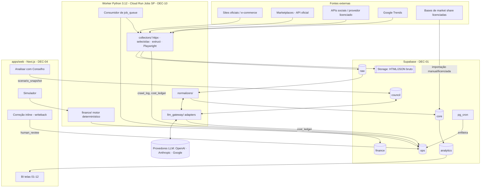
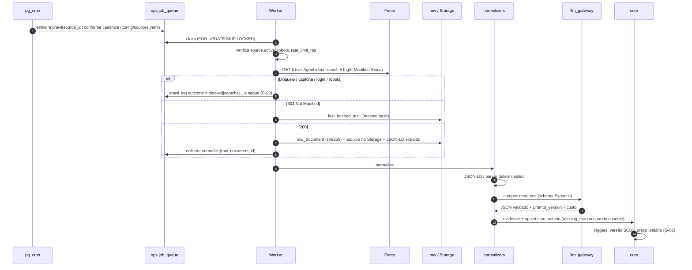
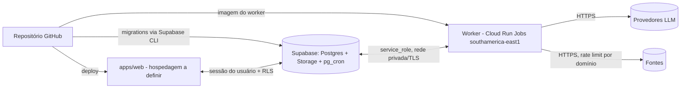

# NEXA LAB — Arquitetura

> **F0-02** · Versão 1.1 · 17/10/2026 (DEC-08, DEC-09 e DEC-10 aprovadas) · Responsável técnico: Iago
> Base normativa: `docs/SPEC.md` (§0, §2, §3, §4). Modelo de dados: `docs/data-dictionary.md`.
> Levantamentos DEC-08, DEC-09 e DEC-10: `docs/research/F0-02-levantamento-fontes.md`.

---

## 1. Princípios de arquitetura

| Princípio | Regra de origem | Como a arquitetura garante |
|---|---|---|
| O banco é a fonte da verdade, não o LLM | A-01 | Toda saída do LLM passa por schema validado antes de ser gravada em `core`. O LLM não tem acesso de escrita direto. |
| Independência de provedor de IA | A-02, DEC-05 | Só `packages/llm_gateway` importa SDK de provedor; os demais pacotes dependem da interface comum. |
| Rastreabilidade de ponta a ponta | G-01, G-02 | Cadeia `source → crawl_run → raw_document → evidence → campo rastreável`, reforçada por constraints no banco. |
| Histórico sem sobrescrita | G-04 | Triggers de versão (SCD2) e bloqueio de DELETE nas entidades. |
| Compliance antes de coletar | C-01 a C-05 | `ops.source` não pode ser ativada sem revisão de ToS/robots; bloqueio vira `crawl_log.outcome`, nunca contorno. |
| Custo medido por execução | A-06 | `ops.cost_ledger` gravado pelo worker e pelo `llm_gateway`. |
| Cálculo financeiro determinístico | G-12 | `packages/finance` calcula; o LLM só propõe premissas (overrides) com evidência. |
| Single-tenant | A-07 | Sem coluna de tenant, sem lógica multi-tenant; RLS controla perfis de um único ambiente. |

---

## 2. Visão de componentes

### 2.1 Responsabilidade por pacote

| Pacote | Responsabilidade | Não faz |
|---|---|---|
| `packages/collectors` | Descobrir URLs (sitemap, categorias), baixar, gravar `raw_document` + Storage, registrar `crawl_log`. Parsers por plataforma (VTEX, Shopify, Nuvemshop, Magento). | Interpretar conteúdo; chamar LLM. |
| `packages/normalizers` | Extrair e classificar a partir de `raw` (JSON-LD primeiro, parser depois, LLM por último), gerar `evidence`, gravar `core` com rastreio. | Coletar; gravar saída sem validação de schema. |
| `packages/llm_gateway` | Interface única `complete(task, input, schema)`; roteamento por tarefa (DEC-06); retry limitado; `prompt_version`; custo em `cost_ledger`. | Persistir dados de negócio. |
| `packages/council` | Montar contexto a partir de `scenario_snapshot`, executar 5 diretores + debate + consolidação, validar citações (A-05). | Calcular números financeiros. |
| `packages/finance` | Importar planilha-base, reproduzir linha de base (tolerância R$ 1), recalcular cenários. | Aceitar valor numérico vindo de texto livre. |
| `packages/radar` | Avaliar gatilhos de alerta sobre `analytics`. | Rotular hipótese como fato. |
| `packages/shared` | Schemas Pydantic, logging estruturado, cliente Supabase, utilitários de hash (`author_hash`, `content_hash`). | — |
| `apps/web` | BI, filtros globais, abertura de evidência, writeback para `ops.human_review`, simulador, botão do Conselho. | Chamar LLM direto do browser; usar `service_role` no cliente. |

---

## 3. Fluxo de coleta e normalização

### 3.1 Ordem de preferência de extração (SPEC §5.1)

1. API oficial ou feed licenciado → `extraction_method = api`.
2. Dados estruturados (`Product`, `Offer`, `AggregateRating`) → `json_ld`.
3. Parser por plataforma → `parser`.
4. LLM com schema validado → `llm` (exige `prompt_version`).
5. Playwright só quando a página exige JS **e** a fonte permite (`access_method = browser`).

---

## 4. Modelo de dados — síntese

Detalhamento completo em `docs/data-dictionary.md` (gerado das migrations).

| Schema | Status | Conteúdo |
|---|---|---|
| `ops` | Implementado (F0-04) | `source`, `job_queue`, `crawl_run`, `crawl_log`, `cost_ledger`, `human_review`, `coverage_report`, `traceable_field` |
| `raw` | Implementado (F0-04) | `raw_document` imutável, encadeado por `previous_document_id` |
| `core` | Implementado (F0-04) | Evidência, taxonomias, marca, produto, variante, preço, composição, claims, benefícios, embalagem, avaliações, ativos, voz do consumidor, tendências, market share |
| `analytics` | Fase 1 | Views materializadas e índices NEXA versionados (`index_definition_version`) |
| `council` | Fase 1 (F1-14) | `scenario_snapshot`, `council_session`, `council_opinion`, `recommendation_sheet`, `knowledge_document` |
| `finance` | Fase 1 (F1-13) | `model_version`, `assumption`, `scenario` |

**Guardrails garantidos pelo banco:** G-01/G-03 (constraints de campo rastreável), G-04 (versionamento e bloqueio de DELETE), G-05 (trigger de preço unitário), G-07/G-11 (constraints de market share), G-10 (`human_review` append-only), C-01/C-03 (constraints de `ops.source`), AC-03 (`evidence_id NOT NULL` em ingredientes e claims).

---

## 5. Topologia de implantação

| Componente | Definição | Status |
|---|---|---|
| Banco, Storage, agendamento | Supabase (Postgres 15+, `pgvector`, `pg_cron`) | DEC-01 aprovada |
| Fila | `ops.job_queue` + worker Python | DEC-03 aprovada |
| Disparo de jobs | `pg_cron` enfileira; worker consome | Adotado (decisão complementar DC-17) |
| Worker (coleta + normalização + Conselho + finanças) | Container Python 3.12 com Chromium em Google Cloud Run Jobs (`southamerica-east1`) | DEC-10 aprovada em 17/10/2026 |
| Interface | Next.js + Supabase Auth | DEC-04 aprovada; hospedagem a definir (ver §9) |
| LLM | `llm_gateway` com adapters | DEC-05/06 aprovadas; benchmark na Fase 1 |
| Embeddings | `pgvector` habilitado, sem coluna | **DEC-07: benchmark na Fase 1** |

### 5.1 Segredos e acesso

| Segredo | Onde fica | Quem usa |
|---|---|---|
| `SUPABASE_SERVICE_ROLE_KEY` | Secret do worker | Worker apenas. Nunca no front-end. |
| `SUPABASE_ANON_KEY` | Variável pública do `apps/web` | Browser, sujeito a RLS |
| Chaves de provedores LLM | Secret do worker | `llm_gateway` apenas |
| `AUTHOR_HASH_SECRET` | Secret do worker | Cálculo de `author_hash` (HMAC-SHA256, C-04) |
| Chaves de APIs de fontes (YouTube, Mercado Livre etc.) | Secret do worker | `collectors` |

---

## 6. Compliance de coleta (C-01 a C-05)

| Controle | Implementação |
|---|---|
| Revisão prévia | `ops.source.tos_reviewed_at` e `robots_allowed` obrigatórios para ativar (constraint). F0-07 preenche para as 20 marcas do MVP. |
| robots.txt em tempo de execução | Collector relê `robots.txt` por domínio a cada execução (cache de 24 h) e registra `robots_disallowed`. |
| Rate limit | `ops.source.rate_limit_rps` + padrão global em `config/rate_limits.yaml`; token bucket por domínio no worker. |
| Backoff | Exponencial com jitter em 429/5xx; `rate_limited` no `crawl_log`. |
| User-Agent | `NexaLabBot/<versão> (+contato)`, configurável. |
| Bloqueio técnico | CAPTCHA, login, paywall, anti-bot → `crawl_log.outcome` correspondente; nenhuma tentativa de contorno. |
| Redes fechadas | `type = social_api` só aceita `api`, `licensed`, `manual` ou `blocked` (constraint). |
| Dados pessoais | Sem nome/handle de consumidor; `author_hash` com segredo; `http_headers` sem cookies. |

---

## 7. Observabilidade, custo e cobertura

- **Logs estruturados** (JSON) do worker com `crawl_run_id`, `job_id`, `source_id`.
- **Custo:** cada chamada ao LLM e cada execução de navegador gera linha em `ops.cost_ledger` (A-06). Relatório "custo por 1.000 páginas/SKUs" sai de agregação (AC-10).
- **Cobertura:** `ops.coverage_report` gerado ao fim de cada ciclo, com completude por campo derivada de `ops.traceable_field` e `missing_reason` (G-09, AC-09).
- **Qualidade:** golden set em `tests/eval` com precisão por campo (AC-02).

---

## 8. Decisões complementares validadas

Registradas a partir das lacunas levantadas em F0-03/F0-04 e **validadas por Iago em 16/10/2026**. Revisões exigem nova aprovação registrada nesta tabela.

| ID | Tema | Decisão vigente |
|---|---|---|
| DC-01 | Escopo de categorias | 8 categorias: skincare facial, proteção solar, maquiagem, lábios, corpo, cabelos (adjacência), fragrâncias, dispositivos/acessórios. Nutricosméticos fora; infantil como subcategoria `fps_infantil` e como público declarado. |
| DC-02 | Arquétipo competitivo | Texto livre rastreável até definição de taxonomia. |
| DC-03 | Faixa de preço da marca | Texto livre rastreável até definição de critério de corte. |
| DC-04 | Canais de venda | Texto livre (`brand.sales_channels`, `market_*.channel`). |
| DC-05 | Embalagem | Tipo, material e mecanismo em texto livre rastreável. |
| DC-06 | Classe funcional de ingrediente | Texto livre. |
| DC-07 | Tipo de pele e área do corpo | Listas fechadas por constraint (8 e 9 valores). |
| DC-08 | Tema e necessidade (voz do consumidor) | Texto livre obrigatório em `signal_classification`. |
| DC-09 | Preço unitário | Calculado sobre preço cheio e sobre preço promocional, em colunas separadas. |
| DC-10 | Descontinuação | Contador `consecutive_misses`; limiar N definido na Fase 1. |
| DC-11 | Limiar de deduplicação por embedding | Depende de DEC-07 (Fase 1). |
| DC-12 | `missing_reason` | Incorporado ao padrão §4.1 com 7 motivos. |
| DC-13 | Acesso | RLS deny-by-default; apenas `service_role` até Q-19. |
| DC-14 | Câmbio de custos | `fx_rate_brl` gravado por linha; fonte do câmbio a definir. |
| DC-15 | Período de market share | `period_start` / `period_end`. |
| DC-16 | Pesos dos índices e limiares de tendência | Descrições qualitativas; calibração na Fase 1 (Q-17). |
| DC-17 | Agendamento | `pg_cron` habilitado para enfileirar; nenhum job criado até o worker existir. GitHub Actions não executa coleta (ver levantamento DEC-10). |
| DC-18 | Taxonomias F0-03 | v1.0 vigente (categoria, subcategoria, formato, benefício, voz do consumidor, frases-sinal, tendência). |
| DC-19 | Categoria piloto do Módulo C (F1-15) | Proteção solar facial × canal farmácia. Aprovada em 17/10/2026. |
| DC-20 | Fenty Beauty × Fenty Skin (§18) | Uma `ops.source` (fentybeauty.com) vinculada às duas marcas via `core.brand_source`. Aprovada em 17/10/2026. |
| DC-21 | Estado inicial das fontes | `access_method = pending_review`, `review_status = pending`, inativas até aprovação F0-07 (`review_status = approved`). |
| DC-22 | Primeiro adapter do `llm_gateway` (F0-08) | Anthropic (SDK `anthropic` 1.x). Rotas provisórias até o benchmark DEC-06: extração/classificação `claude-haiku-5-5` (effort low); Conselho `claude-opus-5-5` (effort high, fallback no servidor). `critical_review` sem rota até existir adapter de segundo provedor. |
| DC-23 | Retenção, backup e acesso (F0-09) | `docs/data-governance.md` v1.0, decisões D1–D6 aprovadas em 17/10/2026 (Thaís sem acesso a `finance`). |
| DC-24 | Projeto Supabase | Projeto `NEXA` (ref `jmuljtnnfrpmdtawpwbd`, PostgreSQL 17, região `us-east-1`), mantido nessa região por decisão de Iago em 17/10/2026. Migrations até `20261017130000` aplicadas; versões em `supabase_migrations.schema_migrations` alinhadas aos nomes dos arquivos. Organização no plano Free (limite de 2 projetos ativos). Projeto de teste `NEXA LAB` (sa-east-1, vazio) criado e pausado no mesmo dia, aguardando exclusão. |

---

## 9. Pendências de arquitetura

| ID | Pendência | Dependência |
|---|---|---|
| P-01 | Cotação de provedor licenciado de social listening (TikTok/Instagram/Facebook) | DEC-08 (Fase 2) + Q-18 |
| P-02 | Cotação do recorte IQVIA para o piloto F1-15 | DEC-09 + Q-18 |
| P-03 | Candidatura à API alpha do Google Trends | DEC-08 |
| P-04 | Hospedagem do `apps/web` (Next.js) | Não coberta por DEC-01 a DEC-10 |
| P-05 | Região do Supabase × worker | Banco mantido em `us-east-1` (DC-24); worker aprovado em `southamerica-east1` (DEC-10). Reavaliar a região do worker no F1 (latência entre continentes) |
| P-06 | Perfis de usuário e policies RLS | Q-19 |
| P-07 | Orçamento mensal de infraestrutura, APIs e modelos | Q-18 |
| P-08 | Inventário da base de conhecimento do Conselho | Q-11 |
